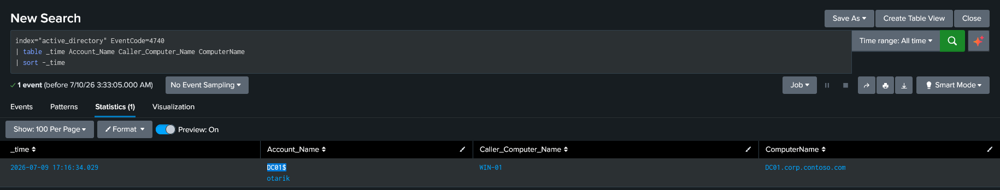

# Account Lockout Detection

## Purpose

Detect user account lockout events that may indicate brute-force attacks, password spraying, credential misuse, or authentication misconfigurations. Account lockouts are important security indicators because they often represent repeated authentication failures against a user account.

---

## MITRE ATT&CK

|Tactic|Technique|
|---|---|
|Credential Access|T1110 – Brute Force|

---

## SPL

```spl
index="active_directory" EventCode=4740
| table _time Account_Name Caller_Computer_Name ComputerName
| sort -_time
```

---

## Detection Evidence



---

## Investigation Guidance

- Identify the locked account.
    
- Determine which computer generated the lockout.
    
- Review preceding Event ID 4625 authentication failures.
    
- Determine whether multiple accounts were locked from the same source.
    
- Identify the authentication method (Kerberos or NTLM) where applicable.
    
- Verify whether the activity originated from an expected workstation.
    
- Determine whether the lockout resulted from malicious activity or normal user behavior.
    

---

## False Positives

Potential legitimate causes include:

- User repeatedly entering an incorrect password.
    
- Cached credentials after a password change.
    
- Scheduled tasks or Windows services using outdated credentials.
    
- Mobile devices repeatedly attempting authentication.
    
- Applications storing expired credentials.
    

---

## Severity

**High**

Although account lockouts can occur during normal user activity, they are frequently associated with password spraying, brute-force attacks, or compromised systems repeatedly attempting authentication. Repeated lockouts across multiple accounts should be treated as a high-priority investigation.

---

## Recommended Response

- Validate the account lockout event.
    
- Review failed authentication activity leading to the lockout.
    
- Identify the originating computer and user.
    
- Determine whether additional accounts were affected.
    
- Contact the user to verify legitimate activity if appropriate.
    
- Reset credentials if compromise is suspected.
    
- Escalate to Tier 2 or Incident Response if evidence suggests malicious authentication attempts.
    

---

## Validation

This detection was validated in a Windows Active Directory laboratory.

Event ID **4740** was successfully generated and verified using **Windows Event Viewer** on the Domain Controller. Due to inconsistent authentication telemetry, the event was not always forwarded reliably into Splunk. Event Viewer was therefore used as the authoritative source to validate the detection logic and confirm account lockout behavior.

In the lab output, **Account_Name** displayed both the subject account and the target account involved in the lockout event.

Known limitation:

- Splunk forwarding for authentication events was inconsistent during testing. Validation relied on Event Viewer when SIEM telemetry was unavailable.
    

---

## References

- MITRE ATT&CK — T1110 Brute Force
    
- Microsoft Windows Security Auditing Documentation
    
- Microsoft Event ID 4740 Documentation
    
- Splunk Enterprise Search Reference
