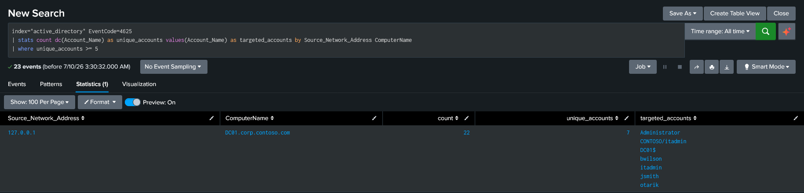

# Password Spraying Detection

## Purpose

Detect a single source attempting to authenticate against multiple Active Directory accounts using failed logon attempts, which may indicate a password spraying attack. Unlike traditional brute-force attacks that target one account with many passwords, password spraying targets many accounts with one or a few common passwords to avoid triggering account lockout policies.

---

## MITRE ATT&CK

|Tactic|Technique|
|---|---|
|Credential Access|T1110.003 – Password Spraying|

---

## SPL

```spl
index="active_directory" EventCode=4625
| stats count dc(Account_Name) as unique_accounts values(Account_Name) as targeted_accounts by Source_Network_Address ComputerName
| where unique_accounts >= 5
```

---

## Detection Evidence



---

## Investigation Guidance

- Verify the source workstation and IP address.
    
- Determine the number of unique accounts targeted.
    
- Review the targeted accounts for privileged or sensitive users.
    
- Correlate preceding and subsequent authentication events (4624, 4740, 4768, 4776).
    
- Determine whether any successful authentication occurred after the failed attempts.
    
- Review activity from the same source host for additional suspicious behavior.
    
- Assess whether similar activity was observed against other systems.
    

---

## False Positives

Potential legitimate causes include:

- Authentication scripts using outdated credentials.
    
- Misconfigured applications repeatedly attempting authentication.
    
- Password synchronization failures.
    
- Bulk administrative testing in a controlled environment.
    
- User support activities involving multiple account verification attempts.
    

---

## Severity

**High**

A successful password spraying attack may compromise multiple user accounts while avoiding account lockout thresholds, making it a common technique used by adversaries during the initial access and credential access phases.

---

## Recommended Response

- Validate the alert against authentication logs.
    
- Identify the originating host and IP address.
    
- Determine whether privileged accounts were targeted.
    
- Review subsequent successful logons from the same source.
    
- Reset compromised credentials if necessary.
    
- Block or isolate the offending source if malicious activity is confirmed.
    
- Escalate the incident to Tier 2 or the Incident Response team when evidence of compromise exists.
    

---

## Validation

This detection was validated in a Windows Active Directory laboratory using Windows Security Event Logs collected by Splunk Enterprise.

Due to an authentication telemetry limitation, newly generated Event ID 4625 entries were not consistently recorded by the Domain Controller during testing. Validation was therefore performed using historical Event ID 4625 telemetry available within Splunk. The detection logic successfully identified multiple failed authentication attempts originating from a single source against several user accounts.

Known limitation:

- New failed logon attempts could not be reliably reproduced because of inconsistent authentication telemetry. Existing historical events were used to validate the detection logic.
    

---

## References

- MITRE ATT&CK — T1110.003 Password Spraying
    
- Microsoft Windows Security Auditing Documentation
    
- Microsoft Event ID 4625 Documentation
    
- Splunk Enterprise Search Reference
