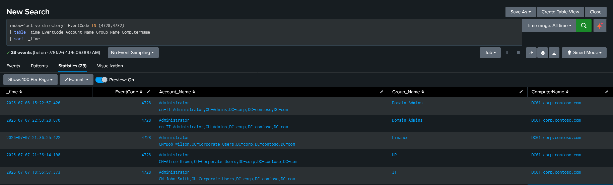

# Privileged Group Modification Detection

## Purpose

Detect modifications to privileged or security-sensitive Active Directory security groups, including groups such as **Domain Admins**, **HR**, **IT**, and **Help Desk** where applicable. Unauthorized changes to security group membership are high-value indicators because attackers frequently add compromised accounts to privileged or security-sensitive groups to obtain or maintain elevated access within the domain.

---

## MITRE ATT&CK

|Tactic|Technique|
|---|---|
|Privilege Escalation|T1098 – Account Manipulation|

---

## SPL

```spl
index="active_directory" EventCode IN (4728,4732) 
| table _time EventCode Account_Name Group_Name ComputerName
| sort -_time
```

---

## Detection Evidence



---

## Investigation Guidance

- Identify the administrator who performed the modification.
    
- Determine which account was added to the group.
    
- Verify the affected security group.
    
- Confirm whether the modification was authorized.
    
- Review authentication events (4624, 4672) for the administrator before the change.
    
- Determine whether the newly added account performed privileged activity after the modification.
    
- Review additional administrative changes occurring around the same time.
    

---

## False Positives

Potential legitimate causes include:

- Approved administrator actions.
    
- User onboarding or role changes.
    
- Helpdesk privilege assignments.
    
- Planned maintenance or operational changes.
    
- Organizational restructuring requiring group membership updates.
    

---

## Severity

**Critical**

Changes to privileged group membership directly affect authorization within Active Directory. Unauthorized additions may indicate privilege escalation, persistence, or domain compromise and should be investigated immediately.

---

## Recommended Response

- Validate that the group modification was authorized.
    
- Identify the administrator responsible for the change.
    
- Verify the business justification for the new membership.
    
- Review recent authentication and administrative activity for both the administrator and the added account.
    
- Remove unauthorized memberships immediately.
    
- Escalate confirmed unauthorized privilege changes to Incident Response.
    

---

## Validation

This detection was validated in a Windows Active Directory laboratory.

A security-enabled global group membership modification was successfully generated and investigated using **Event ID 4728**. The investigation confirmed the following fields:

- Administrator performing the modification.
    
- User account added to the group.
    
- Target security group.
    
- Active Directory domain where the change occurred.

In the lab output, **Account_Name** contained both the administrator account and the added account distinguished name.
    

Although Event ID **4732** is included in the detection because it represents local security group modifications, laboratory validation focused on **4728**, which was the event generated during testing.

---

## References

- MITRE ATT&CK — T1098 Account Manipulation
    
- Microsoft Windows Security Auditing Documentation
    
- Microsoft Event ID 4728 Documentation
    
- Microsoft Event ID 4732 Documentation
    
- Splunk Enterprise Search Reference
