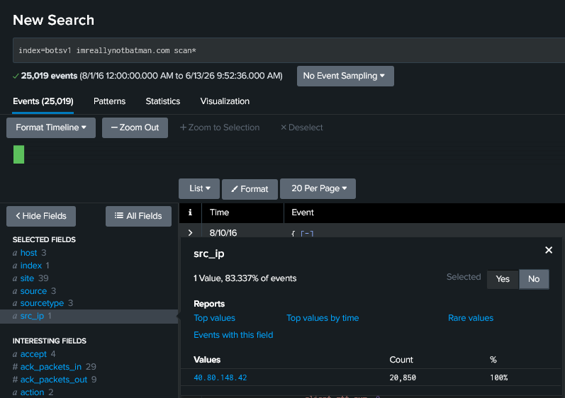
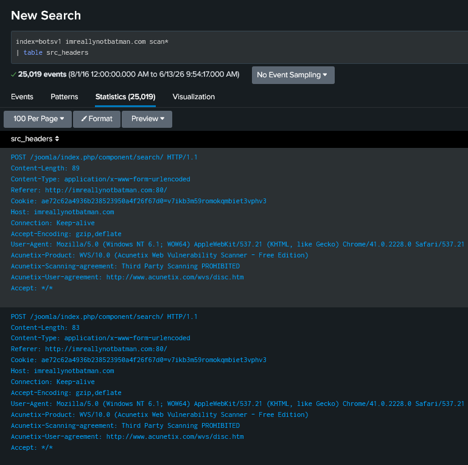
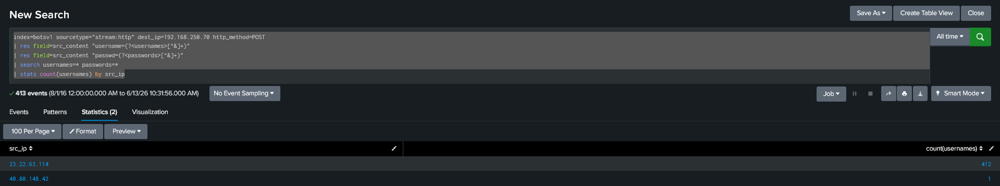
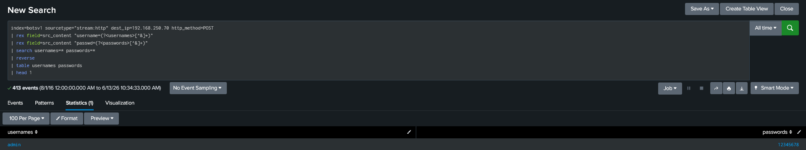
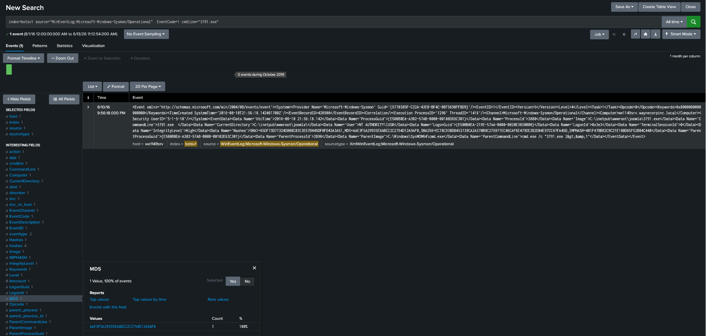
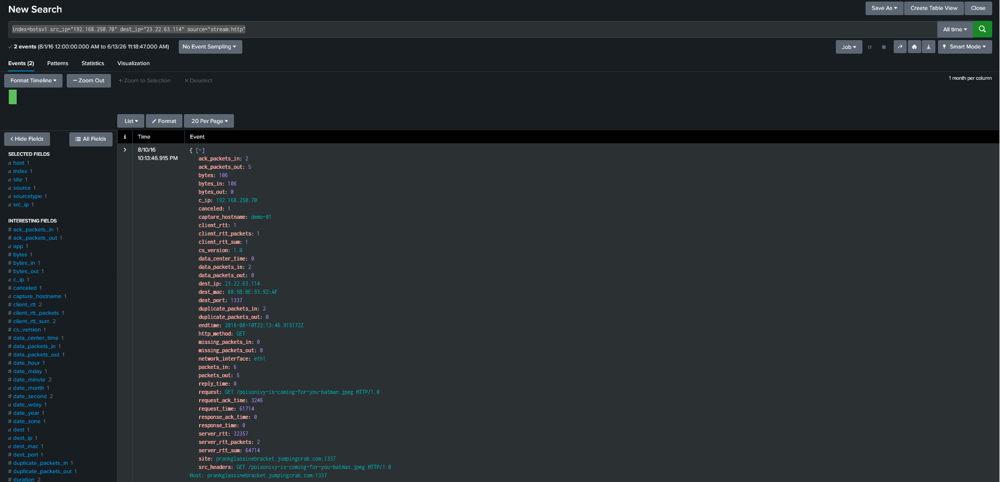
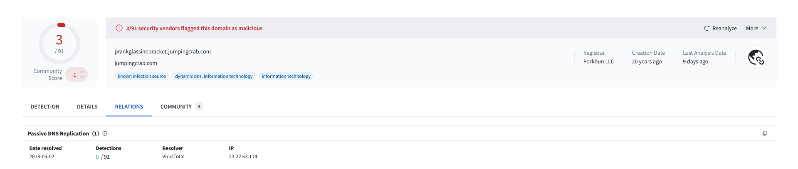

# BOTS v1 – Scenario 1: Web Site Defacement Investigation

## Overview

During this investigation, intelligence from GCPD indicated that the website **imreallynotbatman.com** may have been compromised by the threat group **Po1s0n1vy**.

The objective was to determine whether the compromise occurred, identify attacker infrastructure, reconstruct the attack chain, and analyze post-exploitation activity.

---

# Executive Summary

Analysis of web logs, authentication activity, Sysmon telemetry, and external threat intelligence confirmed that the website was successfully compromised.

The attack consisted of:

1. Vulnerability scanning.
2. CMS identification.
3. Credential brute forcing.
4. Successful authentication.
5. Malicious file upload.
6. Malware execution.
7. Communication with attacker-controlled infrastructure.
8. Retrieval of website defacement content.

---

# Investigation Methodology

Data sources used during the investigation:

| Source                       | Purpose                    |
| ---------------------------- | -------------------------- |
| Stream HTTP Logs             | Web traffic analysis       |
| Sysmon Event ID 1            | Process execution analysis |
| VirusTotal                   | Infrastructure enrichment  |
| External Threat Intelligence | Malware attribution        |

---

# Phase 1 – Reconnaissance

## Vulnerability Scanning

Scan-related activity against the target website identified a single source repeatedly performing reconnaissance.

### Evidence

HTTP header analysis revealed the scanner fingerprint.

### Evidence

### Finding

The attacker used the Acunetix Web Vulnerability Scanner.

---

## CMS Identification

URI inspection revealed Joomla-specific application paths.

### Evidence

### Finding

The target website was running Joomla CMS.

---

# Phase 2 – Credential Access

## Brute Force Activity

HTTP POST requests containing username and password fields revealed a large-scale credential attack.

### Evidence

A single IP address was responsible for hundreds of authentication attempts.

### Finding

The activity was consistent with automated password guessing.

---

## Credential Analysis

Extracted credential data allowed reconstruction of the attacker's password list and authentication behavior.

### Evidence

Analysis identified:

* Initial password attempts
* Password reuse
* Average password characteristics
* Successful authentication timing

### Finding

The attacker successfully identified valid administrator credentials and authenticated shortly afterward.

---

# Phase 3 – Post Exploitation

## File Upload

After authentication, the attacker uploaded an executable to the Joomla server.

### Evidence

Directory listing responses confirmed successful placement of the file on the compromised host.

---

## Malware Execution

Sysmon Event ID 1 telemetry showed execution of the uploaded executable.

### Evidence

The process creation event contained file hash information used for additional investigation and threat intelligence enrichment.

---

# Phase 4 – Infrastructure Correlation

During post-exploitation activity, the compromised server initiated communication with attacker-controlled infrastructure.

### Evidence

The request retrieved content used during the website defacement.

Further investigation revealed the associated attacker domain and supporting infrastructure.

### Evidence

### Finding

The same infrastructure appeared across multiple stages of the attack:

* Brute-force activity
* Domain resolution
* Defacement content delivery
* Post-exploitation communications

This strongly links the observed events to a single attack campaign.

---

# Phase 5 – Threat Intelligence Enrichment

External threat intelligence research identified malware associated with the attacker infrastructure.

The investigation also uncovered a hidden message embedded within the malware artifact.

### Evidence

---

# Attack Timeline

| Phase             | Activity                                   |
| ----------------- | ------------------------------------------ |
| Reconnaissance    | Vulnerability scanning                     |
| Discovery         | Joomla CMS identified                      |
| Credential Access | Brute-force attack initiated               |
| Initial Access    | Successful administrator authentication    |
| Execution         | Malicious executable uploaded and executed |
| Command & Control | Communication with attacker infrastructure |
| Impact            | Defacement content retrieved and deployed  |

---

# Key Findings

* The website was successfully compromised.
* Acunetix was used during reconnaissance.
* Administrative credentials were obtained through brute force.
* A malicious executable was uploaded and executed.
* Infrastructure was reused across multiple attack stages.
* External intelligence linked the activity to known Po1s0n1vy tooling.

---

# Lessons Learned

* Reconnaissance activity can reveal attacker tooling early in an intrusion.
* Authentication telemetry is critical for identifying brute-force attacks.
* Correlating web logs with endpoint telemetry strengthens investigations.
* Infrastructure correlation provides valuable attribution evidence.
* Threat intelligence enrichment often completes the attack narrative.

---

# Skills Demonstrated

* Splunk SPL
* Log Analysis
* Threat Hunting
* Web Traffic Analysis
* Authentication Investigation
* Sysmon Analysis
* Threat Intelligence Enrichment
* Timeline Reconstruction
* Incident Documentation

---

# Investigation Validation Appendix

The following table contains the answers obtained during the investigation. These values are provided for challenge validation purposes and should be interpreted alongside the investigative evidence documented throughout this report.

| Question | Description                                          | Answer                                                                                                                                                                                                                                                                             |
| -------- | ---------------------------------------------------- | ---------------------------------------------------------------------------------------------------------------------------------------------------------------------------------------------------------------------------------------------------------------------------------- |
| 101      | Vulnerability Scanner Source IP                      | `40.80.148.42`                                                                                                                                                                                                                                                                     |
| 102      | Vulnerability Scanner Vendor                         | `Acunetix`                                                                                                                                                                                                                                                                         |
| 103      | Content Management System                            | `Joomla`                                                                                                                                                                                                                                                                           |
| 104      | Defacement File                                      | `poisonivy-is-coming-for-you-batman.jpg`                                                                                                                                                                                                                                           |
| 105      | Malicious FQDN                                       | `prankglassinebracket.jumpingcrab.com`                                                                                                                                                                                                                                             |
| 106      | Attacker Infrastructure IP                           | `23.22.63.114`                                                                                                                                                                                                                                                                     |                                                                                                                                                                                                                                                                                |
| 108      | Brute Force Source IP                                | `23.22.63.114`                                                                                                                                                                                                                                                                     |
| 109      | Uploaded Executable                                  | `3791.exe`                                                                                                                                                                                                                                                                         |
| 110      | MD5 Hash of Uploaded Executable                      | `AAE3F5A29935E6ABCC2C2754D12A9AF0`                                                                                                                                                                                                                                                 |
| 111      | Malware SHA256                                       | `9709473ab351387aab9e816eff3910b9f28a7a70202e250ed46dba8f820f34a8`                                                                                                                                                                                                                 |
| 112      | Special Hex Code                                     | `53 74 65 76 65 20 42 72 61 6e 74 27 73 20 42 65 61 72 64 20 69 73 20 61 20 70 6f 77 65 72 66 75 6c 20 74 68 69 6e 67 2e 20 46 69 6e 64 20 74 68 69 73 20 6d 65 73 73 61 67 65 20 61 6e 64 20 61 73 6b 20 68 69 6d 20 74 6f 20 62 75 79 20 79 6f 75 20 61 20 62 65 65 72 21 21 21` |                                                                                                                                                                                                                                                                           |
| 114      | First Brute Force Password                           | `12345678`                                                                                                                                                                                                                                                                         |
| 115      | Coldplay Song Password                               | `yellow`                                                                                                                                                                                                                                                                           |
| 116      | Correct CMS Administrator Password                   | `batman`                                                                                                                                                                                                                                                                           |
| 117      | Average Password Length                              | `6`                                                                                                                                                                                                                                                                                |
| 118      | Time Between Password Discovery and Successful Login | `92.17`                                                                                                                                                                                                                                                                            |
| 119      | Unique Passwords Attempted                           | `412`                                                                                                                                                                                                                                                                              |

---

# References

* Splunk Boss of the SOC (BOTS) v1 Dataset
* VirusTotal
* Sysmon Event ID 1 Documentation
* Acunetix Web Vulnerability Scanner Documentation
