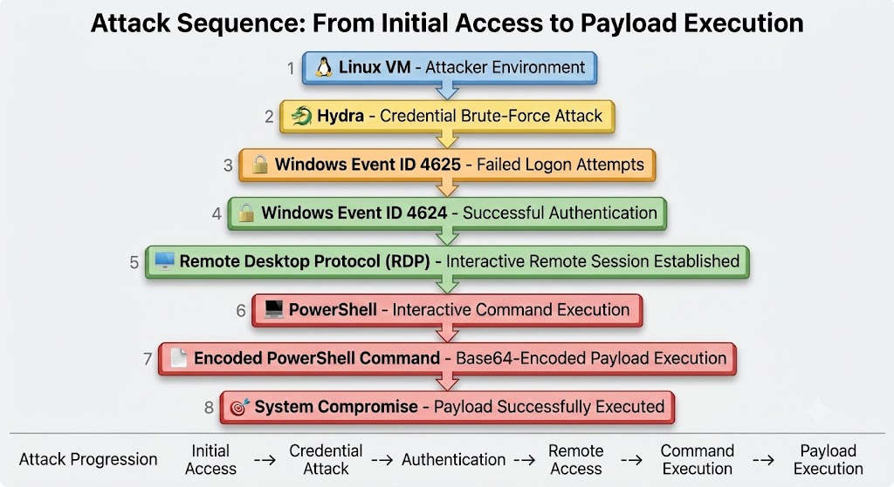
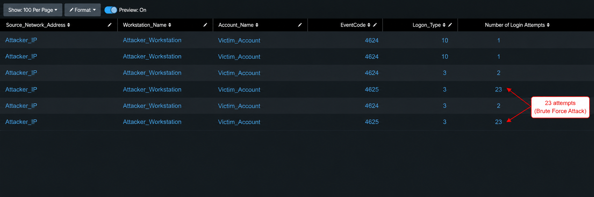
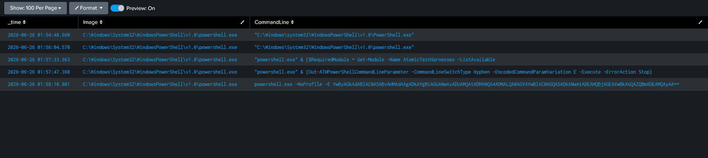
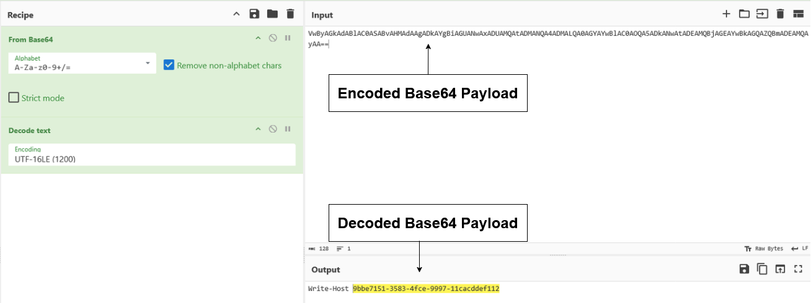

# Incident Investigation

## Simulated RDP Brute Force Leading to PowerShell Execution

---

## 1. Executive Summary

This report documents a simulated attack in which a Linux attacker host performed repeated Remote Desktop Protocol (RDP) authentication attempts against a Windows endpoint. The activity produced multiple failed Windows logon events, followed by successful authentication and establishment of an interactive RDP session.

After successful access, PowerShell was executed on the target system. Sysmon process creation telemetry showed use of the Atomic Red Team test harness and execution of an encoded PowerShell command. The encoded payload was decoded using CyberChef and confirmed to be a benign `Write-Host` command used for simulation.

The investigation demonstrates how Windows Security logs, Sysmon, Splunk, and CyberChef can be used together to reconstruct an attack chain from initial access attempts to command execution.

---

## 2. Investigation Objective

The goal of this investigation was to answer the following questions:

1. Did repeated failed RDP logons occur from one source?
2. Did the attacker eventually authenticate successfully?
3. Was an interactive RDP session established?
4. Was PowerShell executed after access was obtained?
5. What did the encoded PowerShell payload contain?

---

## 3. Environment

| Component             | Description                      |
| --------------------- | -------------------------------- |
| Attacker Host         | Linux VM                         |
| Target Host           | Windows VM                       |
| SIEM                  | Splunk                           |
| Endpoint Telemetry    | Windows Security Logs, Sysmon    |
| Simulation Tools      | Hydra, xfreerdp, Atomic Red Team |
| Payload Analysis Tool | CyberChef                        |

**Anonymization Note:** Usernames, hostnames, and IP addresses were anonymized in screenshots. The report uses `Attacker_IP`, `Attacker_Workstation`, and `Victim_Account` as consistent labels.

---

## 4. Attack Scenario



**Figure 1 – Attack sequence from initial access to payload execution**

The simulated attack followed this sequence:

1. The attacker used a Linux VM to perform RDP credential brute-force attempts.
2. The Windows target logged repeated failed authentication events.
3. Valid credentials were eventually used successfully.
4. An interactive RDP session was established.
5. PowerShell was executed on the target host.
6. An encoded PowerShell command was executed through the Atomic Red Team test harness.
7. The encoded payload was decoded and reviewed.

---

## 5. Investigation Findings

### 5.1 RDP Authentication Activity

The first Splunk search focused on Windows Security events related to failed and successful authentication from the attacker source.

```spl
index="windows_logs" source="WinEventLog:Security" EventCode IN (4624,4625) Source_Network_Address="<Attacker_IP>"
| dedup _time Source_Network_Address Workstation_Name Account_Name EventCode Logon_Type
| table _time Source_Network_Address Workstation_Name Account_Name EventCode Logon_Type
| sort _time
```



**Figure 2 – Authentication summary showing failed and successful RDP logons**

The results showed repeated failed logons from `Attacker_IP` against `Victim_Account`. These failures were logged as **Windows Security Event ID 4625** with **Logon Type 3**, indicating network authentication attempts.

The same source later generated successful **Windows Security Event ID 4624** logons. The successful events included **Logon Type 3** and **Logon Type 10**. Logon Type 10 is important because it confirms that a remote interactive RDP session was created, not only that network authentication succeeded.

| Event ID | Logon Type | Meaning                                   |
| -------- | ---------: | ----------------------------------------- |
| 4625     |          3 | Failed network logon attempt              |
| 4624     |          3 | Successful network authentication         |
| 4624     |         10 | Successful remote interactive RDP session |

This pattern supports the conclusion that the attacker performed repeated RDP authentication attempts and eventually gained access using valid credentials.

---

### 5.2 PowerShell Execution

After confirming successful RDP access, the investigation searched Sysmon process creation events for PowerShell execution.

```spl
index="windows_logs" sourcetype="WinEventLog:Microsoft-Windows-Sysmon/Operational" EventCode=1 User="WIN-LAB\\Victim_Account" Image="C:\\Windows\\System32\\WindowsPowerShell\\v1.0\\powershell.exe"
| dedup Image CommandLine
| table _time Image CommandLine
| sort _time
```



**Figure 3 – Sysmon Event ID 1 showing PowerShell execution**

Sysmon Event ID 1 showed PowerShell execution after the successful RDP session. The command history included the Atomic Red Team test harness and a final PowerShell command using the `-E` parameter.

The `-E` parameter is a shortened form of `-EncodedCommand`. Encoded PowerShell is suspicious because it can hide the true command being executed. Even when the payload is later confirmed as benign, encoded PowerShell should be reviewed because it is commonly used in malicious tradecraft.

---

### 5.3 Encoded Payload Review

The encoded PowerShell payload was extracted from the Sysmon command line and decoded using CyberChef.



**Figure 4 – CyberChef decoding of the encoded PowerShell payload**

The payload was decoded using Base64 with UTF-16LE encoding. The decoded result was a benign `Write-Host` command. This confirmed that the simulation successfully generated encoded PowerShell telemetry, but the payload itself was not malicious.

The key investigation value is that the analyst did not stop at identifying Base64. The payload was decoded and validated before reaching a conclusion.

---

## 6. Incident Timeline

| Time  | Activity                            | Evidence                                      |
| ----- | ----------------------------------- | --------------------------------------------- |
| 01:37 | RDP brute-force activity began      | Windows Security Event ID 4625                |
| 01:47 | Successful authentication occurred  | Windows Security Event ID 4624, Logon Type 3  |
| 01:53 | Interactive RDP session established | Windows Security Event ID 4624, Logon Type 10 |
| 01:56 | PowerShell execution began          | Sysmon Event ID 1                             |
| 01:58 | Encoded PowerShell command executed | Sysmon Event ID 1                             |
| 01:58 | Payload decoded and reviewed        | CyberChef                                     |

---

## 7. MITRE ATT&CK Mapping

| Technique                  | ID        | Evidence                                             |
| -------------------------- | --------- | ---------------------------------------------------- |
| Brute Force                | T1110     | Repeated failed RDP logons                           |
| Remote Services: RDP       | T1021.001 | Successful Logon Type 10 RDP session                 |
| PowerShell                 | T1059.001 | Sysmon process creation showing PowerShell execution |
| Encoded PowerShell Command | T1059.001 | PowerShell command line using `-E` / encoded payload |

---

## 8. Detection Opportunities

This scenario suggests three useful detection opportunities:

1. **Repeated failed RDP logons**
   Detect multiple Event ID 4625 failures from the same source against the same account within a short time window.

2. **Successful RDP logon after repeated failures**
   Detect Event ID 4624 Logon Type 10 when it follows repeated failed authentication from the same source.

3. **Encoded PowerShell execution**
   Detect PowerShell command lines containing `-EncodedCommand`, `-enc`, or `-E`.

The strongest detection would correlate all three behaviors: repeated failed RDP logons, successful RDP access, and PowerShell execution shortly afterward.

---

## 9. SOC Recommendations

* Restrict RDP access to trusted networks or VPN access only.
* Enforce account lockout or rate-limiting for repeated failed authentication.
* Monitor successful RDP logons that occur after multiple failed attempts.
* Alert on encoded PowerShell execution, especially after suspicious authentication.
* Correlate Windows Security logs with Sysmon process creation events.
* Use MFA for remote access where possible.

---

## 10. Conclusion

The investigation confirmed a simulated RDP brute-force attack followed by successful authentication and interactive remote access. Windows Security logs showed repeated failed logons, successful authentication, and establishment of an RDP session. Sysmon then captured PowerShell execution and an encoded PowerShell command executed after access was obtained.

The decoded payload was benign and part of an Atomic Red Team simulation. However, the attack chain remains realistic from a SOC investigation perspective because it demonstrates how an analyst can move from authentication evidence to endpoint execution evidence and validate the final payload.

This investigation shows the value of correlating Splunk searches, Windows Security events, Sysmon process telemetry, and payload decoding to reconstruct an incident from initial access through command execution.

---

## 11. Lessons Learned

* Event ID 4625 helps identify failed authentication activity.
* Event ID 4624 with Logon Type 10 confirms successful RDP session creation.
* `Source_Network_Address` is the most reliable field for identifying the remote source.
* Sysmon Event ID 1 provides strong evidence of process execution.
* Encoded PowerShell should be decoded before reaching a conclusion.
* Authentication logs show access; Sysmon shows what happened after access.

---

## Appendix A: SPL Queries Used

### Authentication Timeline

```spl
index="windows_logs" source="WinEventLog:Security" EventCode IN (4624,4625) Source_Network_Address="<Attacker_IP>"
| dedup _time Source_Network_Address Workstation_Name Account_Name EventCode Logon_Type
| table _time Source_Network_Address Workstation_Name Account_Name EventCode Logon_Type
| sort _time
```

### PowerShell Execution

```spl
index="windows_logs" sourcetype="WinEventLog:Microsoft-Windows-Sysmon/Operational" EventCode=1 User="WIN-LAB\\Victim_Account" Image="C:\\Windows\\System32\\WindowsPowerShell\\v1.0\\powershell.exe"
| dedup Image CommandLine
| table _time Image CommandLine
| sort _time
```
