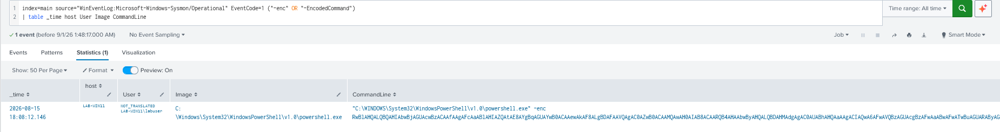
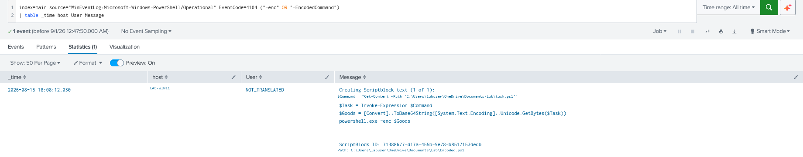

# Encoded PowerShell Detection

> Privacy note: Hostnames, usernames, and profile paths shown in the evidence were anonymized before publication.

## Purpose

Detect PowerShell processes using encoded commands. Encoding can be used legitimately, but it can also hide suspicious or malicious commands.

---

## MITRE ATT&CK

| Tactic | Technique |
| --- | --- |
| Execution | [T1059.001 — Command and Scripting Interpreter: PowerShell](https://attack.mitre.org/techniques/T1059/001/) |

---

## SPL

```spl
index=main source="WinEventLog:Microsoft-Windows-Sysmon/Operational"
EventCode=1
Image="*\\powershell.exe"
("-enc" OR "-EncodedCommand")
| table _time host User Image CommandLine
```

---

## Detection Evidence

### Sysmon Event ID 1 — Encoded PowerShell Execution

[](./images/sysmon_encoded_powershell_execution.png)

### PowerShell Event ID 4104 — Script Block Content

[](./images/powershell_4104_script_block.png)

---

## Investigation Guidance

- Confirm the process is `powershell.exe`.
- Extract the encoded payload from the command line.
- Decode the Base64 content.
- Review the decoded command for suspicious behavior.
- Check the user, process context, and related activity.

---

## False Positives

Encoded PowerShell is not automatically malicious. Administrative scripts or legitimate software may use encoded commands for reliability or to avoid quoting issues.

The decoded content should be reviewed before classifying the activity as suspicious.

---

## Severity

**Medium**

Encoded commands may hide suspicious activity, but legitimate software can also use them.

---

## Recommended Response

Decode and review the payload. If malicious activity is confirmed, investigate the related process, user, files, and any additional execution activity.

---

## Validation

Tested using a benign encoded PowerShell command created in the lab.

The detection identified the Sysmon Event ID 1 process containing the encoded payload. PowerShell Event ID 4104 was also reviewed to verify the script content.

---

## References

- [MITRE ATT&CK — T1059.001: Command and Scripting Interpreter: PowerShell](https://attack.mitre.org/techniques/T1059/001/)
- [Microsoft PowerShell documentation](https://learn.microsoft.com/en-us/powershell/)
- [Microsoft Sysinternals Sysmon documentation](https://learn.microsoft.com/en-us/sysinternals/downloads/sysmon)
