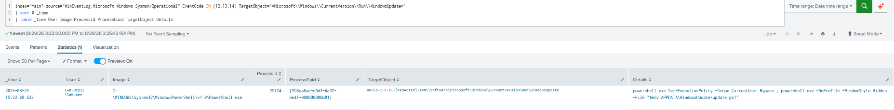

# Registry Run/RunOnce Key Modification

> Privacy note: Hostnames, usernames, profile names, account identifiers, and Windows SIDs shown in the evidence were anonymized before publication.

## Purpose

Detect changes to Registry Run and RunOnce keys that may be used for persistence.

---

## MITRE ATT&CK

| Tactic | Technique |
| --- | --- |
| Persistence / Privilege Escalation | [T1547.001 — Registry Run Keys / Startup Folder](https://attack.mitre.org/techniques/T1547/001/) |

---

## SPL

```spl
index=main source="WinEventLog:Microsoft-Windows-Sysmon/Operational"
EventCode IN (12,13,14)
TargetObject IN (
    "*\\Software\\Microsoft\\Windows\\CurrentVersion\\Run\\*",
    "*\\Software\\Microsoft\\Windows\\CurrentVersion\\RunOnce\\*"
)
| table _time host User Image ProcessId ProcessGuid EventCode EventType TargetObject Details
```

---

## Detection Evidence

[](./images/registry_run_runonce_key_modification.png)

The detection identified a `WindowsUpdate` Run-key modification made through PowerShell.

---

## Investigation Guidance

- Check the Registry path and configured value.
- Identify the user and process that made the change.
- Review the command or file path in `Details`.
- Look for unusual locations, hidden PowerShell, or encoded commands.
- Confirm whether the activity belongs to legitimate software.

---

## False Positives

Legitimate applications such as Microsoft OneDrive may use Run keys to start at user logon.

The suspicious lab example used:

```powershell
powershell.exe Set-ExecutionPolicy -Scope CurrentUser Bypass ; powershell.exe -NoProfile -WindowStyle Hidden -File "$env:APPDATA\WindowsUpdate\update.ps1"
```

The AppData path, hidden PowerShell execution, and Run-key persistence made it worth investigating.

---

## Severity

**Medium**

Run keys are commonly used by legitimate software, so detections should be investigated before being treated as malicious.

---

## Recommended Response

If confirmed malicious, preserve evidence, remove the Registry value and related file, and check for additional persistence or related activity.

---

## Validation

Tested in the Registry persistence lab. The detection successfully identified the `WindowsUpdate` Run-key modification in Sysmon telemetry.

---

## References

- [MITRE ATT&CK — T1547.001: Registry Run Keys / Startup Folder](https://attack.mitre.org/techniques/T1547/001/)
- [Microsoft Sysinternals Sysmon documentation](https://learn.microsoft.com/en-us/sysinternals/downloads/sysmon)
