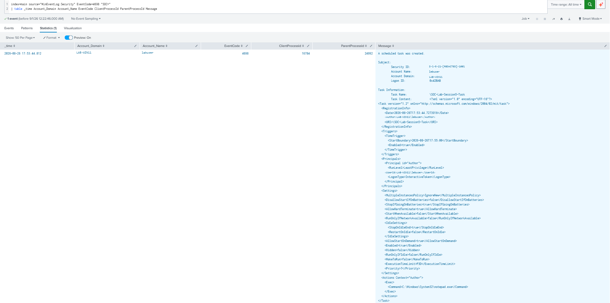

# Scheduled Task Creation Detection

> Privacy note: Domain names, usernames, account identifiers, and Windows SIDs shown in the evidence were anonymized before publication.

## Purpose

Detect the creation of Windows Scheduled Tasks that may be used to execute programs or scripts. Scheduled Tasks are commonly used for legitimate automation but can also be abused for execution or persistence.

---

## MITRE ATT&CK

| Tactic | Technique |
| --- | --- |
| Execution / Persistence / Privilege Escalation | [T1053.005 — Scheduled Task/Job: Scheduled Task](https://attack.mitre.org/techniques/T1053/005/) |

---

## SPL

```spl
index=main source="WinEventLog:Security" EventCode=4698
| table _time Account_Domain Account_Name EventCode ClientProcessId ParentProcessId Message
```

---

## Detection Evidence

[](./images/scheduled_task_creation_event_4698.png)

---

## Investigation Guidance

- Review the task name, trigger, and configured action.
- Identify the user account that created the task.
- Check the executable or script path and any command arguments.
- Look for unusual locations, scripts, or unexpected privilege levels.
- Confirm whether the task belongs to legitimate software.

---

## False Positives

**Legitimate case:** A Bitdefender scheduled task was observed running at user logon from its expected installation directory under `C:\Program Files\Bitdefender Agent\`.

**Simulated case:** The lab task `SOC-Lab-Session5-Task` used a time-based trigger to execute `C:\Windows\System32\notepad.exe`. The task was harmless but demonstrated how a Scheduled Task can automatically run a configured program.

---

## Severity

**Medium**

Scheduled Tasks are widely used by legitimate software, so a detection should be investigated before being considered malicious.

---

## Recommended Response

Review the task properties and associated executable or script. If confirmed malicious, disable the task, preserve relevant evidence, and investigate the associated file and related activity.

---

## Validation

Tested against the Session 5 scheduled-task lab. The detection successfully identified the creation of `SOC-Lab-Session5-Task` through Security Event ID 4698.

The event showed the task trigger, user context, and configured action to execute `notepad.exe`.

---

## References

- [MITRE ATT&CK — T1053.005: Scheduled Task/Job: Scheduled Task](https://attack.mitre.org/techniques/T1053/005/)
- [Microsoft Event 4698: A scheduled task was created](https://learn.microsoft.com/en-us/windows/security/threat-protection/auditing/event-4698)
