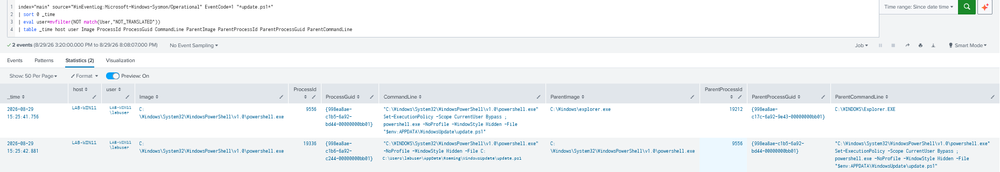
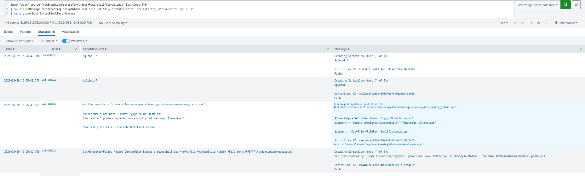
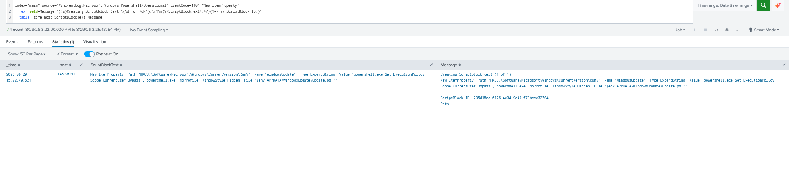
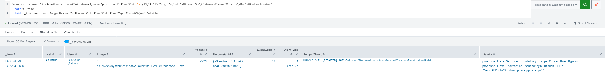
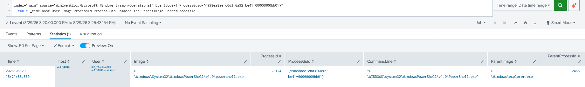
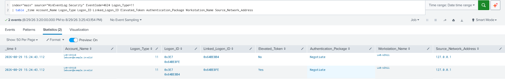

# Investigation Report #6 — Registry Persistence

> Privacy note: Usernames, hostnames, profile names, account identifiers, and the Windows SID shown in this report were anonymized before publication. This does not affect the investigation findings or event correlation.

## 1. Goal

Apply a full investigation of PowerShell and Registry abuse for persistence.

---

## 2. Scenario

To simulate malicious activity, I created a similar but harmless scenario.

I created a PowerShell script named `update.ps1` and placed it under:

```text
C:\Users\labuser\AppData\Roaming\WindowsUpdate\
```

The script was designed to create a file named `update_status.dat` in the same directory. The intended file content was a message indicating successful execution and the time at which the script ran.

To establish persistence, I created a value named `WindowsUpdate` under the current user's Registry Run key:

```text
HKCU\Software\Microsoft\Windows\CurrentVersion\Run
```

The value type was `ExpandString`. Its data contained PowerShell commands that first changed the execution policy for the current user and then executed `update.ps1` without loading the user's PowerShell profile and without displaying a PowerShell window.

I then logged off and logged back in to trigger the Run-key value. After confirming that the script executed, I started the investigation in Splunk using different log sources.

For the investigation, I assumed that an alert had been received for a suspicious script located at:

```text
C:\Users\labuser\AppData\Roaming\WindowsUpdate\update.ps1
```

---

## 3. Initial Alert / Investigation Starting Point

The investigation started from the assumption that a SOC alert identified the following suspicious PowerShell script:

```text
C:\Users\labuser\AppData\Roaming\WindowsUpdate\update.ps1
```

The objective was to determine whether the script had executed, what it did, why it executed, and whether persistence had been established.

---

## 4. Artifact Summary

| Artifact | Value |
|---|---|
| Suspicious script | `C:\Users\labuser\AppData\Roaming\WindowsUpdate\update.ps1` |
| Intended output artifact | `C:\Users\labuser\AppData\Roaming\WindowsUpdate\update_status.dat` |
| Registry location | `HKCU\Software\Microsoft\Windows\CurrentVersion\Run` |
| Registry value name | `WindowsUpdate` |
| Registry value type | `ExpandString` |
| Primary execution process | `powershell.exe` |
| Registry writer process | `powershell.exe` |
| Registry writer PID | `25124` |
| Registry writer ProcessGuid | `{998ea8ae-c0d3-6a92-be41-00000000bb01}` |
| Payload execution PID | `19336` |
| Payload execution ProcessGuid | `{998ea8ae-c1b6-6a92-c244-00000000bb01}` |

> Note: No hash values are included because they were not collected as part of this investigation.

---

## 5. Investigation

### 5.1 Identifying Script Execution

I first searched Sysmon process-creation telemetry for references to `update.ps1`.

The search returned two Sysmon Event ID 1 events associated with PowerShell. The first PowerShell process, PID `9556`, executed the current-user execution-policy bypass and launched another PowerShell instance. The child process, PID `19336`, directly executed `update.ps1`.

The second process was the primary execution process for the suspicious script.

**Observed execution chain:**

```text
explorer.exe -> powershell.exe (PID 9556) -> powershell.exe (PID 19336) -> update.ps1
```

**Observed execution details:**

```text
Timestamp: 2026-08-29 15:25:42.881
Image: C:\Windows\System32\WindowsPowerShell\v1.0\powershell.exe
ProcessId: 19336
ProcessGuid: {998ea8ae-c1b6-6a92-c244-00000000bb01}
CommandLine: powershell.exe -NoProfile -WindowStyle Hidden -File C:\Users\labuser\AppData\Roaming\WindowsUpdate\update.ps1
User: LAB-WIN11\labuser
```

[](./images/image1.png)

---

### 5.2 Reviewing the Script Behavior

I then moved to the PowerShell Operational log and searched for Event ID 4104.

The results showed the contents of `update.ps1`. The script defined an artifact path, generated a timestamp, created a message, and used `Out-File` to write the content to `update_status.dat`.

The captured script block showed:

```powershell
$ArtifactLocation = "C:\Users\labuser\AppData\Roaming\WindowsUpdate\update_status.dat"

$Timestamp = Get-Date -Format "yyyy-MM-dd HH:mm:ss"
$Content = "Update completed successfully.`nTimestamp: $Timestamp"

$content | Out-File -FilePath $ArtifactLocation
```

The event also identified the script path as:

```text
C:\Users\labuser\AppData\Roaming\WindowsUpdate\update.ps1
```

This confirmed what the script was designed to do.

[](./images/image2.png)

> Evidence limitation: Sysmon Event ID 11 did not capture creation of `update_status.dat`, and no other collected evidence directly confirmed that the file was successfully created. PowerShell Event ID 4104 only shows that the script was configured to write the file.

---

### 5.3 Identifying the Cause of Execution

After confirming that the script had executed, I investigated why it executed automatically.

I reviewed earlier PowerShell Event ID 4104 events and identified a `New-ItemProperty` command that created a value under the current user's Registry Run key.

The command configured a value named `WindowsUpdate` under:

```text
HKCU:\Software\Microsoft\Windows\CurrentVersion\Run
```

The value was configured as `ExpandString` and contained PowerShell commands that changed the current user's execution policy and then executed `update.ps1`.

**Observed PowerShell command:**

```powershell
New-ItemProperty -Path "HKCU:\Software\Microsoft\Windows\CurrentVersion\Run" -Name "WindowsUpdate" -Type ExpandString -Value 'powershell.exe Set-ExecutionPolicy -Scope CurrentUser Bypass ; powershell.exe -NoProfile -WindowStyle Hidden -File "$env:APPDATA\WindowsUpdate\update.ps1"'
```

**Timestamp:** `2026-08-29 15:22:49.621`

[](./images/image3.png)

---

### 5.4 Confirming the Registry Modification

To confirm that the Registry value was actually written, I searched Sysmon Registry telemetry for Events 12, 13, and 14 and filtered for the `WindowsUpdate` Run value.

A Sysmon Event ID 13 confirmed that the Registry value was set.

**Observed Registry evidence:**

```text
Timestamp: 2026-08-29 15:22:49.628
EventType: SetValue
Image: C:\WINDOWS\system32\WindowsPowerShell\v1.0\PowerShell.exe
ProcessId: 25124
ProcessGuid: {998ea8ae-c0d3-6a92-be41-00000000bb01}
TargetObject: HKU\S-1-5-21-[REDACTED]-1001\Software\Microsoft\Windows\CurrentVersion\Run\WindowsUpdate
User: LAB-WIN11\labuser
Details: powershell.exe Set-ExecutionPolicy -Scope CurrentUser Bypass ; powershell.exe -NoProfile -WindowStyle Hidden -File "$env:APPDATA\WindowsUpdate\update.ps1"
```

This independently confirmed the Registry modification shown in PowerShell telemetry.

[](./images/image4.png)

---

### 5.5 Identifying the Registry Writer Process

I used the ProcessGuid from the Sysmon Event ID 13 event to locate the corresponding Sysmon Event ID 1 process-creation event.

The matching event identified the PowerShell process responsible for writing the Registry value.

**Observed process details:**

```text
Timestamp: 2026-08-29 15:21:55.580
Image: C:\Windows\System32\WindowsPowerShell\v1.0\powershell.exe
ProcessId: 25124
ProcessGuid: {998ea8ae-c0d3-6a92-be41-00000000bb01}
ParentImage: C:\Windows\explorer.exe
ParentProcessId: 12488
User: LAB-WIN11\labuser
```

The matching ProcessGuid connects the PowerShell process creation event to the later Registry value modification.

[](./images/image5.png)

---

### 5.6 Correlating User Logon Activity

Because the persistence mechanism used the Registry Run key, I investigated user logon activity after the Registry value had been created and before `update.ps1` executed.

Windows Security Event ID 4624 showed a Logon Type 11 event at:

```text
2026-08-29 15:24:43.112
```

The event indicated a cached interactive logon. Two related 4624 records were generated at the same time, one with an elevated token and one without.

The logon occurred after the Run-key value was established and before the PowerShell execution of `update.ps1`.

[](./images/image6.png)

---

## 6. Timeline

| Timestamp | Source | Event ID | Activity |
|---|---|---:|---|
| 2026-08-29 15:21:55.580 | Sysmon | 1 | PowerShell process PID 25124 was created under `explorer.exe`. |
| 2026-08-29 15:22:49.621 | PowerShell Operational | 4104 | `New-ItemProperty` command processed to configure the `WindowsUpdate` Run value. |
| 2026-08-29 15:22:49.628 | Sysmon | 13 | `WindowsUpdate` Run value was set by PowerShell PID 25124. |
| 2026-08-29 15:24:43.112 | Windows Security | 4624 | Cached interactive user logon occurred. |
| 2026-08-29 15:25:41.756 | Sysmon | 1 | PowerShell PID 9556 executed the current-user execution-policy bypass and launched child PowerShell PID 19336. |
| 2026-08-29 15:25:42.881 | Sysmon | 1 | PowerShell PID 19336 executed `update.ps1`. |
| 2026-08-29 15:25:43.153 | PowerShell Operational | 4104 | Script block content of `update.ps1` was recorded, showing the `Out-File` operation targeting `update_status.dat`. |

---

## 7. MITRE ATT&CK Mapping

| Tactic | Technique |
|---|---|
| Persistence | [T1547.001 — Registry Run Keys / Startup Folder](https://attack.mitre.org/techniques/T1547/001/) |
| Execution | [T1059.001 — PowerShell](https://attack.mitre.org/techniques/T1059/001/) |

---

## 8. Assessment and Conclusion

The investigation identified a PowerShell-based persistence mechanism using the current user's Registry Run key.

The `WindowsUpdate` Registry value was created under the Run key and configured to launch PowerShell and execute `update.ps1`. Sysmon Event ID 13 confirmed that the value was written by PowerShell PID 25124. The same ProcessGuid was correlated with a Sysmon Event ID 1 process-creation event showing that the writer process originated from `explorer.exe` under the `LAB-WIN11\labuser` user context.

A subsequent cached interactive logon occurred, after which `explorer.exe` launched PowerShell PID 9556. PID 9556 executed the current-user execution-policy bypass and launched child PowerShell PID 19336, which executed `update.ps1`. PowerShell Event ID 4104 recorded the script contents and showed that the script was designed to write `update_status.dat` in the same `WindowsUpdate` directory.

This activity represents persistence because the Run-key value was configured before the user logon and caused the specified PowerShell command to execute after the user logged in.

The lab activity was intentionally harmless. The script was designed only to write a status file. However, in a real environment, activity with similar characteristics would require investigation because it combines a Run-key persistence location, PowerShell execution, a user-writable AppData path, a value named `WindowsUpdate`, `-NoProfile`, and hidden PowerShell execution.

---

## 9. Recommended Response

Based on the evidence collected in this investigation, realistic SOC response actions would include:

- Investigate the origin and purpose of `update.ps1`.
- Validate whether the `WindowsUpdate` Run value is authorized.
- Preserve relevant evidence before removing the persistence mechanism.
- Remove the unauthorized Run-key value and associated script if the activity is confirmed to be unwanted.
- Search for related Run-key persistence activity on the same endpoint and other systems where appropriate.
- Review surrounding PowerShell activity for additional suspicious commands.
- Monitor or detect suspicious modifications to Registry Run keys using available Registry telemetry such as Sysmon Event ID 13.

---

## 10. Evidence Summary

| Image | Evidence |
|---|---|
| [Image 1](./images/image1.png) | Sysmon Event ID 1 — PowerShell execution of `update.ps1` |
| [Image 2](./images/image2.png) | PowerShell Event ID 4104 — contents and behavior of `update.ps1` |
| [Image 3](./images/image3.png) | PowerShell Event ID 4104 — `New-ItemProperty` Run-key configuration |
| [Image 4](./images/image4.png) | Sysmon Event ID 13 — confirmed `WindowsUpdate` Registry value modification |
| [Image 5](./images/image5.png) | Sysmon Event ID 1 — PowerShell writer process correlated through ProcessGuid |
| [Image 6](./images/image6.png) | Windows Security Event ID 4624 — user logon between persistence establishment and payload execution |

---

## 11. Evidence Notes

- Sysmon Event ID 1 records process creation. It does not by itself prove script behavior; the command line showed PowerShell launching `update.ps1`.
- PowerShell Event ID 4104 is Script Block Logging telemetry.
- Sysmon Event ID 13 independently confirmed that the Registry value was set.
- The Registry Run-key modification timestamp is `2026-08-29 15:22:49.628`; the earlier Sysmon Event ID 1 timestamp for PID 25124 represents process creation, not persistence establishment.
- Sysmon Event ID 11 did not capture creation of `update_status.dat`, and no other collected evidence directly confirmed successful file creation.
